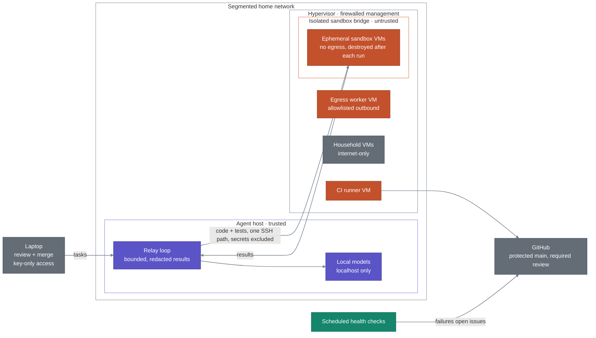
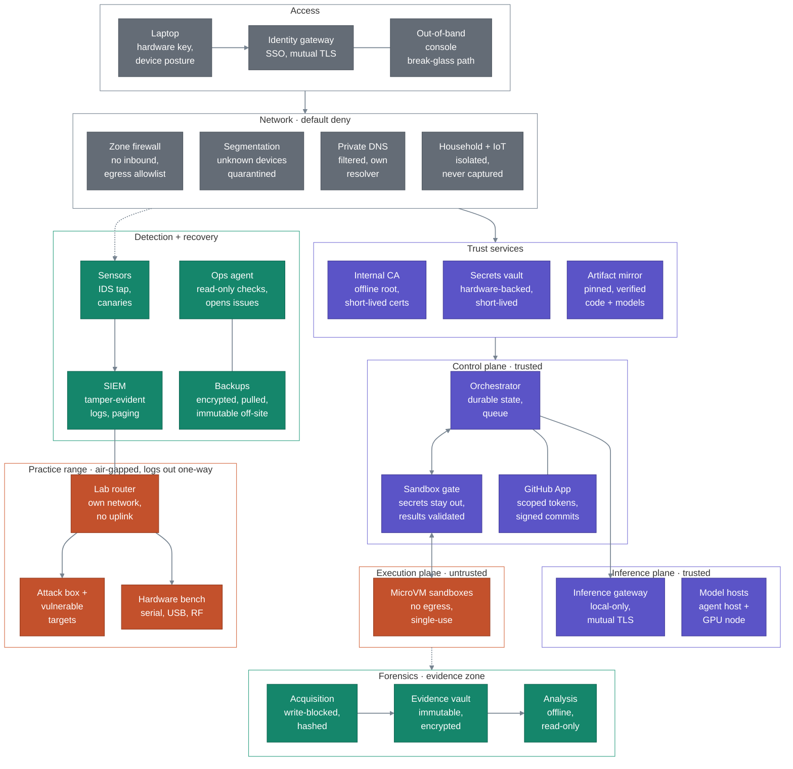

# Otter Creek Homelab

A small self-hosted lab in Vermont where my AI agents, local models, and test sandboxes run. It's described here by **role**: no addresses, hostnames, or configs. That's on purpose.

## Why it exists

- Run open-weight models locally, so long agent loops cost electricity, not API credit.
- Give coding agents somewhere disposable to run untrusted code, away from my laptop and my accounts.
- Practice the operations side: virtualization, networking, backups, runbooks, incident cleanup.

## Architecture

| Role | What it does |
|---|---|
| Agent host | Serves open-weight models (MLX and Ollama) on localhost only and runs the relay loop |
| Hypervisor | Proxmox VE. Management is reachable only from the laptop and the agent host, SSH is key-only, and every VM is backed up nightly |
| Sandbox VMs | Built from a hardened template with CPU, memory, and disk caps. No internet, no route to the rest of the lab, destroyed after each run. They never see my keys |
| Egress worker | The one VM allowed outbound, and only to an allowlist |
| CI runner | Self-hosted GitHub Actions runner in its own VM, off the hypervisor host |
| Network | Segmented home network: fixed addresses for lab hosts, IoT and guest devices on their own segments, household VMs limited to the internet |

## Featured: the relay loop

A tag-team coding loop that runs entirely on local models:

1. A **builder** model writes code and tests for a task.
2. The code goes to a fresh sandbox VM and the tests run there under a hard timeout, enforced on the worker with a local backstop.
3. Two **reviewer** models critique the result.
4. Repeat until the tests pass and both reviewers are clean, or the round budget runs out.

What makes it trustworthy:

- **Secrets never leave the host.** `.env*`, keys, `.pem` files and `.git` are excluded from every copy, and there's no agent forwarding.
- **Sandbox output is treated as hostile.** Results are size-bounded and stripped of anything that looks like a credential before a reviewer model reads them.
- **Infrastructure failures aren't blamed on the model.** A dropped connection, a timeout, or the wrong worker answering is retried once, then the run stops with a distinct exit code. The builder only gets a failed round for its own code.
- **Every outcome is classified.** Pass, failing tests, timeout, no tests collected, missing dependency, nothing saved. Each lands in a per-round log.
- **Runaway tests get killed.** A deliberately hanging test is part of the examples, and it must be killed by the worker timeout.

## Operations

- **A living runbook.** The lab's runbook is a live page that a scheduled agent sweeps every night. It folds in what changed, restores anything missing, and trims stale steps. A static runbook goes stale in a week.
- **Checks that fail loud.** Scheduled checks cover backups, disk, exposed ports, sandbox egress, and credential scope. Any failure opens a GitHub issue, so nothing breaks quietly.
- **Nightly backups.** Every VM is snapshotted nightly with a rolling retention window.
- **Guardrails on the repos agents touch.** Branch protection on main, required review, no force pushes, linear history. Agents open PRs; I merge.
- **Incident practice.** I've already had to rotate an exposed gateway token and track down a runaway API-cost leak (wrong model tier, low cache hit rate, a chatty heartbeat).

## In progress

Moving from "hardened homelab" toward a lab where every trust boundary is physical, built the cheap way where the cheap way is also the right way: single-board computers, e-waste, and owned gear. Where it's headed:

- **Dedicated hardware per plane.** Orchestration, inference, and execution on separate machines, so untrusted code never shares a host with anything that holds state or credentials.
- **Default-deny network.** Managed switching with per-plane segments behind a zone firewall, unknown devices quarantined on arrival, and a mirror port feeding intrusion-detection sensors and canary services that page when touched.
- **Private DNS.** A filtering resolver doing its own recursion on a single-board computer, so lookups stay in the lab and ads, trackers, and known-bad domains die at the edge.
- **Trust services.** An internal certificate authority with an offline root issuing short-lived certs, a secrets vault backed by a hardware key, and an internal artifact mirror so builds install pinned, hash-verified packages and models instead of reaching for the internet.
- **A real control plane.** An orchestrator with durable state and a queue, a sandbox gate that keeps secrets out and validates results on the way back, and a scoped GitHub App in place of personal tokens.
- **An inference gateway.** One front door for every model, local-only with mutual TLS, plus a GPU node for models too large for the agent host.
- **MicroVM sandboxes.** Faster, smaller throwaway runners behind the sandbox gate.
- **An air-gapped practice range.** A lab router with no uplink fencing the attack box, deliberately vulnerable targets, and a hardware bench (serial, USB, RF — powered by a recycled ATX supply), with logs leaving one-way only.
- **A forensics pipeline with chain of custody.** Write-blocked, hashed acquisition — retired phones and e-waste drives are the practice corpus — into an immutable encrypted evidence vault, analyzed offline.
- **Access done right.** Hardware-key sign-in with device posture checks, and an out-of-band console as the break-glass path for when the network itself is down.
- **Observability.** A SIEM with tamper-evident logs and paging, fed by the sensors and the range; an ops agent that runs read-only checks and opens issues when something fails.
- **3-2-1 backups.** Pull-based so a compromised host can't reach them, encrypted, with an immutable off-site copy, automated restore tests, and battery backup for the rack.
- **Ephemeral CI.** A fresh runner per job, gone when the job ends.
- **Infrastructure as code** for the sandbox VMs, so a rebuild is one command.

— [James Richmond](https://github.com/JamesTRichmond)
