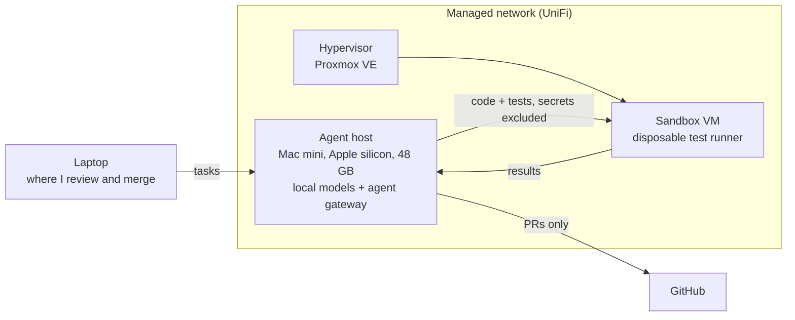

# Otter Creek Homelab

A small self-hosted lab in Vermont where my AI agents, local models, and test sandboxes run. It's described here by **role**: no addresses, hostnames, or configs. That's on purpose.

## Why it exists

- Run open-weight models locally, so long agent loops cost electricity, not API credit.
- Give coding agents somewhere disposable to run untrusted code, away from my laptop and my accounts.
- Practice the operations side: virtualization, networking, backups, runbooks, incident cleanup.

## Architecture

| Role | What it does |
|---|---|
| Agent host | Serves open-weight models (MLX and Ollama) and runs a persistent agent gateway |
| Hypervisor | Proxmox VE. Holds sandbox VMs that can be thrown away and rebuilt |
| Sandbox VM | Runs generated code and tests. It never sees my keys |
| Network | UniFi-managed home network |

## Featured: the relay loop

A tag-team coding loop that runs entirely on local models:

1. A **builder** model writes code and tests for a task.
2. The code goes to the sandbox VM and the tests run there under a hard timeout, enforced on the worker with a local backstop.
3. Two **reviewer** models critique the result.
4. Repeat until the tests pass and both reviewers are clean, or the round budget runs out.

What makes it trustworthy:

- **Secrets never leave the host.** `.env*`, keys, `.pem` files and `.git` are excluded from every copy, and there's no agent forwarding.
- **Infrastructure failures aren't blamed on the model.** A dropped connection, a timeout, or the wrong worker answering is retried once, then the run stops with a distinct exit code. The builder only gets a failed round for its own code.
- **Every outcome is classified.** Pass, failing tests, timeout, no tests collected, missing dependency, nothing saved. Each lands in a per-round log.
- **Runaway tests get killed.** A deliberately hanging test is part of the examples, and it must be killed by the worker timeout.

## Operations

- **A living runbook.** The lab's runbook is a live page that a scheduled agent sweeps every night. It folds in what changed, restores anything missing, and trims stale steps. A static runbook goes stale in a week.
- **Guardrails on the repos agents touch.** Branch protection on main, no force pushes, linear history. Agents open PRs; I merge.
- **Incident practice.** I've already had to rotate an exposed gateway token and track down a runaway API-cost leak (wrong model tier, low cache hit rate, a chatty heartbeat).

## What I'd do next

- Infrastructure as code for the sandbox VMs, so a rebuild is one command.
- Off-site backups with a tested restore.
- Metrics on model throughput and loop pass rates.

— [James Richmond](https://github.com/JamesTRichmond)
